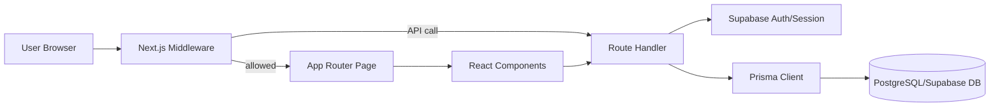

# Architecture

## System Architecture Summary

The project uses a **modular monolith** architecture on top of **Next.js App Router**:

- UI routes/pages and API handlers live in one codebase (`app/`)
- Server-side business logic primarily uses Prisma and Supabase auth/session
- Shared cross-cutting modules are in `lib/`
- Domain-specific UI is grouped in `components/`
- Data persistence is PostgreSQL (via Prisma), hosted with Supabase

## Key patterns in use

1. **App Router + Route Handlers**
   - Feature pages in `app/**/page.tsx`
   - Backend endpoints in `app/api/**/route.ts`
2. **Domain partitioning**
   - Vendor, customer, and admin flows are separated by route prefixes and components
3. **Shared service layer**
   - `lib/supabase/*`, `lib/prisma.ts`, `lib/validations.ts`, `lib/payments/*`
4. **Middleware-driven access control**
   - `middleware.ts` enforces auth and admin route checks
5. **Schema-first data model**
   - `prisma/schema.prisma` defines relational structure and indexes
6. **Composable UI primitives**
   - Common controls in `components/ui/*`, domain blocks in feature folders

## Runtime flow (request path)

## Domain route boundaries

- **Auth/Public**: `/`, `/login`, `/signup`, `/unauthorized`
- **Vendor app**: `/dashboard/*`, `/onboarding/*`, `app/api/vendor/*`
- **Customer storefront**: `/<slug>`, `/<slug>/checkout`, `/<slug>/orders/[orderNumber]`, `app/api/customer/*`
- **Admin app**: `/admin/*`, `app/api/admin/*`

## Data architecture highlights

- Core entities: Vendor, Category, MenuItem, Order, OrderItem, Customer
- Platform entities: Admin, AdminLog, Payout, Transaction, CommissionSettings, PlatformSettings
- Indexing strategy supports vendor/order/customer/admin operational queries
- Payment and payout lifecycle modeled explicitly with Transaction + Payout entities

## Architecture constraints for agents

- Keep domain concerns separated (do not mix admin logic into customer/vendor modules).
- Preserve middleware and auth assumptions when adding routes.
- Reuse existing validation and shared helper modules before introducing new abstractions.
- Favor incremental changes over broad rewrites.
